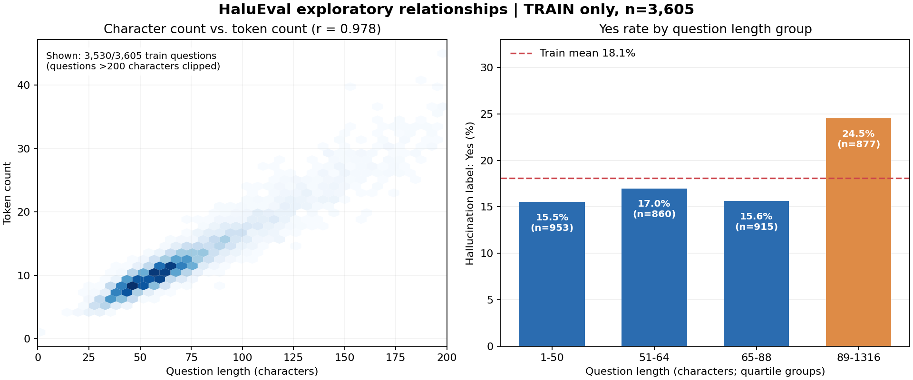
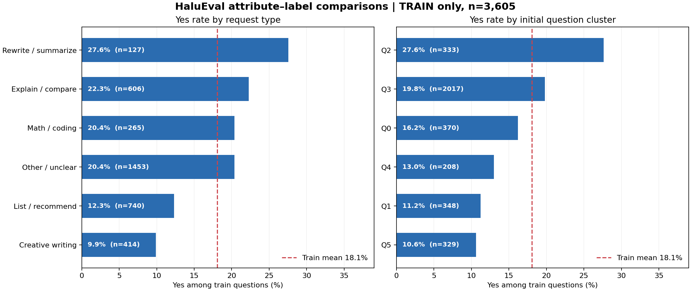

# 8차시 — 군집 결과 정리와 데이터 속성 간 관계 분석·시각화

> 2026-10-31에 진행한 연속 작업 중 네 번째 단계의 기록이며, 2026-11-07에 속성 관계 분석과 시각화를 추가했다. 앞서 했던 CSV 추출·업로드 작업도 그대로 보존했다.

## 1. 오늘 결정한 것

지금까지 진행한 전처리와 군집화 결과를 나중에 다시 분석하고 모델 학습에 활용할 수 있도록 CSV 파일로 정리하기로 했다. 질문 1개를 나타내는 표와 단어 1개를 나타내는 표는 행의 의미가 서로 다르므로 한 파일로 억지로 합치지 않고 구분했다.

| GitHub data/ 파일 | 행 × 열 | 정리한 내용 |
| --- | ---: | --- |
| questions_clustered.csv | 4,507 × 68 | 전체 질문의 수치 특징·질문군집·단어군집 비중·주제/요청 특성 |
| questions_multistage_q1.csv | 2,734 × 37 | 수정 대형 질문군집 Q′1에서 진행한 3단계 재분류 |
| questions_subtopics_train.csv | 3,605 × 8 | 학습 질문에 부여한 세부 주제 및 교차 그룹 |
| words_clustered_refined.csv | 5,650 × 18 | 단어별 군집·역할·의미 그룹·검토 상태 |

각 CSV의 행 수, 열 수, 식별자 중복 여부를 확인했고 업로드된 파일이 로컬 분석 결과와 동일한지도 점검했다. 데이터 설명용 data/README.md에 원본 HaluEval 저장소와 general_data.json의 링크, 각 CSV의 분석 대상, 학습/시험 범위, 군집 해석의 주의점을 기록했다. 원본 MIT 라이선스 문구도 별도로 보존했다.

처음에는 기존 분석 코드와 결과 파일 33개를 한꺼번에 GitHub 작업 브랜치에 올리고 초안 PR을 만들었다. 그러나 실제로 필요한 결과와 중간 작업이 뒤섞여 저장소가 복잡해 보였고, 나중에 다시 실행하는 순서도 충분히 정리되지 않았다는 문제가 있었다. 내가 롤백을 요청하여 PR을 병합하지 않고 닫고, 작업 브랜치도 변경 전 main과 같은 상태로 되돌렸다. 기존 main의 코드는 손대지 않았다.

이후 업로드 범위를 **검토한 CSV 4개와 출처·라이선스 안내 2개 파일**로 줄여 main 브랜치의 data/ 폴더에 반영했다. 원본 JSONL 전체를 다시 저장소에 복제하지는 않고 공식 원본 링크를 제공했다.

마지막으로 이날 실제로 내가 보낸 군집화 관련 질문을 시간순으로 정리해 `chat/2026-10-31.txt`에 남겼다. 길게 붙여 넣은 과제 안내문과 평가 기준은 제외했다. 다만 과거 AI 답변 전체를 그대로 가져올 수 없는 부분이 있어, **질문은 원문**, **답변은 확인된 실험 결과를 바탕으로 한 요약**이라고 표시했다. 기록을 실제 원문과 혼동하지 않도록 하기 위해서다.

### 추가 활동 — 데이터 속성 간 관계 분석과 시각화(2026-11-07)

CSV를 정리한 뒤, 이전 차시에서 추출한 질문의 여러 속성이 서로 어떻게 연결되는지 확인했다. 모델을 최종 평가할 때 사용할 시험 데이터의 정답이 분석에 섞이지 않도록 **전체 4,507개 중 학습 데이터 3,605개만** 이번 관계 분석에 사용했다. 학습 질문의 Yes는 652개(18.1%)이고 No는 2,953개였다.

먼저 `char_count`(질문 글자 수)와 `token_count`(단어 수)는 **수치형**, `intent_type`(요청 유형)과 `question_cluster`(질문군집)는 **범주형**, `y`(Yes=1, No=0)는 **이진 범주형 라벨**로 구분했다. 같은 수치로 저장된 `question_cluster`도 군집 번호의 크기가 수량을 뜻하는 것은 아니므로 범주형으로 처리했다.

속성의 종류에 따라 그래프를 다르게 선택했다.

| 비교할 속성 | 선택한 시각화·통계 | 확인한 사실 |
| --- | --- | --- |
| 질문 글자 수 ↔ 단어(토큰) 수 | 밀도 산점도와 피어슨 상관계수 | 상관계수 **r≈0.978**로 매우 강한 양의 관계가 있었다. 두 열은 비슷한 길이 정보를 담으므로 이후 모델에서 중복 효과를 살펴볼 필요가 있다. |
| 질문 길이 구간 ↔ Yes/No 라벨 | 질문 길이를 4개 구간으로 나눈 막대그래프 | **89자 이상**인 학습 질문 877개의 Yes 비율은 **24.5%(215개)**였고, **88자 이하** 2,728개의 Yes 비율은 **16.0%(437개)**였다. 차이는 약 **8.5%p**였다. |
| 요청 유형 ↔ Yes/No 라벨 | 요청 유형별 Yes 비율의 가로 막대그래프 | `rewrite_or_summarize`는 **27.6%(35/127)**, `creative_writing`은 **9.9%(41/414)**로 차이가 났다. 유형별 질문 수가 다르므로 비율과 표본 수를 함께 표시했다. |
| 초기 질문군집 Q ↔ Yes/No 라벨 | 군집별 Yes 비율의 가로 막대그래프 | Q2는 **27.6%(92/333)**, Q1은 **11.2%(39/348)**였다. 군집마다 비율이 달랐으나 군집 번호 자체에 고정된 의미가 있는 것은 아니다. |

첫 번째 그래프의 산점도는 읽기 쉽도록 200자 이하 질문 3,530개만 화면에 표시했다. **상관계수 계산과 막대그래프의 통계에는 학습 데이터 3,605개 전체를 사용했으며, 200자 초과 75개를 데이터에서 제거하지 않았다.**

이 시각화를 통해 질문의 길이, 요청 유형, 기존 질문군집에 따라 **데이터셋에 기록된 할루시네이션 Yes 비율이 다를 수 있음**을 확인했다. 하지만 질문이 길어서 오류가 발생했다고 단정할 수는 없다. 질문의 주제·난도·응답 방식이나 데이터셋 구성 등 다른 요인도 영향을 줄 수 있기 때문이다. 따라서 이 그래프는 **후속 모델에서 검토할 후보 특징을 찾는 탐색적 분석 결과**로 사용하고, 최종 예측 성능은 보류한 시험 데이터 902개로 별도 평가하기로 했다.

## 2. AI에게 보낸 프롬프트(원문)

> 그럼 프로젝트 진행하면서 내 git 에 실시간으로 반영까지 해줄 수 있어?

> 뭔가 애매한거같은데

> 변경사항 모두 롤백시켜줄수있냐

> 군집화된 데이터 csv로 뽑아서 깃허브 그 아까 보낸 곳에 data 폴더 만들어서 넣어줘

> 원본 데이터 링크도 같이 기제해 줘

> 아 또 그 chat 폴더에 오늘자로 너와의 채팅기록이 필요한데, 아까 말했듯이 긁어온것들 제외하고 오늘 너와 군집화에 대해 대화하고 이를 data폴더에 저장한 부분까지의 모든 질문, 답변 내용을 chat에 텍스트 파일로 기록해 줘

> 이 사진 반영해서 8차시 수정해줘

> 기존의 8차시까지의 내용에서 추가로 위 사진의 내용을 진행했다는 구조로 5,6,7,8,을 각각 조정, 수정해 줘

## 3. AI가 준 것 중 고치거나 버린 것과 그 이유

- 첫 GitHub 반영에서 실험 스크립트와 중간 결과를 33개 파일로 한꺼번에 올린 방식을 되돌렸다. 저장소에 파일이 많다고 해서 분석 과정이 더 명확해지는 것은 아니었기 때문이다.
- 05.md의 프롬프트 기록 중 실제 내가 보낸 문장과 다르게 적힌 표현을 확인했다. 실제 대화에 있는 '일단 군집을 추가해줘'로 바로잡고, 하루 동안의 작업을 전처리·재군집화·품질 검증·자료 추출의 네 단계로 다시 나눠 적기로 했다.
- 서로 범위가 다른 4개 데이터셋을 하나의 표로 합치지 않았다. 전체 질문 4,507개, Q′1 학습 부분집합 2,734개, 전체 학습 질문 3,605개, 단어 어휘 5,650개는 각각 행이 의미하는 대상이 다르다.
- 단어별 train_yes_rate와 같은 발생률 통계는 분석 결과로 남겼지만, 향후 예측 모델의 입력 변수로 바로 사용하지 않기로 했다. 학습 정답에서 계산된 값이기 때문에 잘못 사용하면 정답 정보가 섞일 수 있다.
- 수업 과제 안내문을 길게 붙여 넣은 텍스트는 내가 직접 제안한 군집화 요청으로 둔갑시키지 않았다. 일부 답변의 원문을 확인할 수 없어 chat 기록에서 이 부분을 '답변 요약'으로 구분했다.
- 처음에는 파일 정리만 하고 8차시를 마무리했지만, 뒤늦게 **속성 간 관계를 시각화하고 그 결과를 해석하는 활동이 빠졌음**을 확인해 보완했다. 단순 분포 히스토그램은 두 속성의 관계를 보여 주기 어려워, 수치형끼리는 산점도, 범주형과 라벨은 비율 막대그래프를 선택했다.
- 시험 데이터 902개의 Yes/No 정답을 이번 시각화에 포함하지 않았다. 그 정답을 보고 특징을 골라버리면 이후 모델 성능 평가가 공정하지 않을 수 있기 때문이다.
- 질문 길이가 길거나 특정 군집에 속하면 반드시 오류가 생긴다는 해석은 버렸다. 그래프에서 보인 차이는 **연관성**이며, 할루시네이션의 **직접적인 원인**이라는 근거는 아니기 때문이다.

## 4. 느낀 점

분석을 오래 하다 보니 결과 파일이 너무 많아져 어떤 파일이 최종 결과이고 어떤 파일이 실험 도중 만들어진 것인지 헷갈렸다. 처음 GitHub에 한꺼번에 올렸을 때도 정리가 충분하지 않다고 느껴 다시 되돌렸다. 그 뒤 필요한 CSV를 목적별로 나눠 올리니 어떤 데이터로 다음 분석을 이어가야 할지 훨씬 명확해졌다. 앞으로는 실험을 진행한 기록과 실제로 사용할 데이터를 구분하고, 데이터를 공개할 때 출처와 전처리 기준도 함께 남기려고 한다.

추가로 직접 그래프를 만들며 **데이터를 분류해 놓는 것과 데이터에서 관계를 발견하는 것은 다른 활동**이라는 점을 알게 되었다. 질문 길이와 단어 수는 거의 함께 늘어났고, Yes 비율은 길이 구간과 요청 유형에 따라 차이를 보였다. 다만 이것만으로 예측이 잘된다고 할 수 없으므로 다음에는 여러 모델을 같은 조건에서 비교해 볼 필요가 있다고 느꼈다.

GitHub data 폴더: https://github.com/SAME522/yaruring_data_project_hallucination/tree/main/data

원본 데이터: https://github.com/RUCAIBox/HaluEval/blob/main/data/general_data.json
